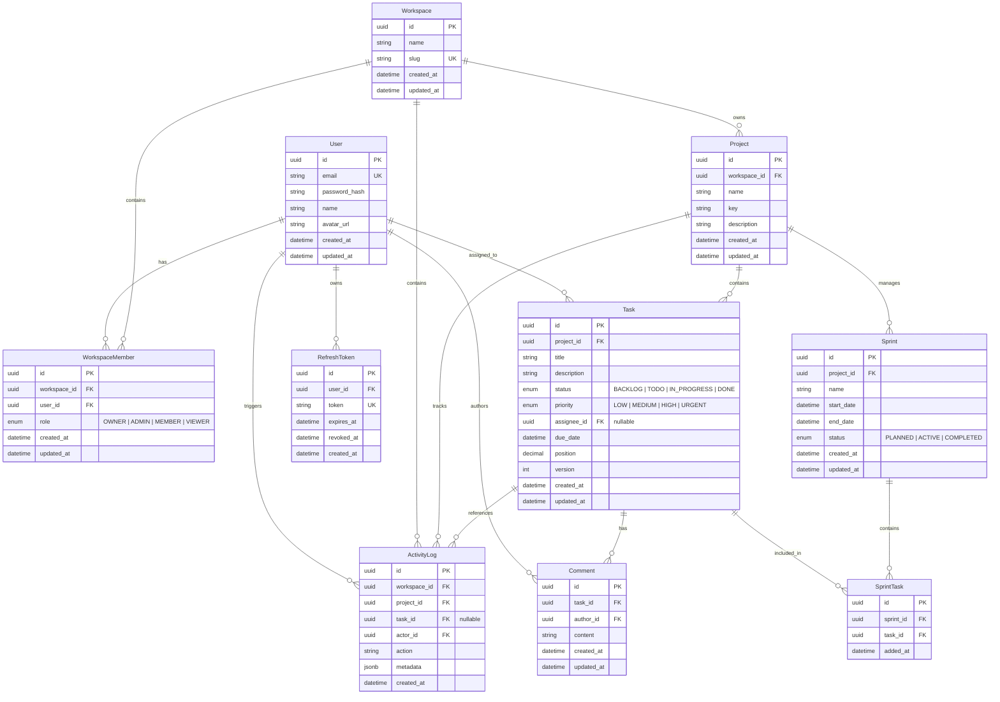

# SprintFlow Database Schema

SprintFlow utilizes PostgreSQL managed via Prisma ORM.

## Entity Relationship Diagram

## Foreign Key `onDelete` Behaviors

Every foreign key has an intentional `onDelete` action to ensure data integrity and avoid orphan records:

| Relation | Foreign Key | Action | Rationale |
|---|---|---|---|
| `WorkspaceMember -> Workspace` | `workspace_id` | `CASCADE` | When a workspace is deleted, all member associations are cleaned up. |
| `WorkspaceMember -> User` | `user_id` | `CASCADE` | When a user is purged, all of their workspace memberships are removed. |
| `Project -> Workspace` | `workspace_id` | `CASCADE` | Projects exist within a workspace; removing the workspace purges all child projects. |
| `Task -> Project` | `project_id` | `CASCADE` | Tasks belong to a specific project; deleting the project cascades to its tasks. |
| `Task -> User` | `assignee_id` | `SET NULL` | If an assignee is deleted, the task remains intact in the project and becomes unassigned. |
| `Comment -> Task` | `task_id` | `CASCADE` | Comments belong to a task; deleting the task cleans up all associated comments. |
| `Comment -> User` | `author_id` | `CASCADE` | Purging a user removes their posted comments. |
| `ActivityLog -> Workspace` | `workspace_id` | `CASCADE` | Deleting a workspace removes workspace-level activity history. |
| `ActivityLog -> Project` | `project_id` | `CASCADE` | Deleting a project cleans up project activity history. |
| `ActivityLog -> Task` | `task_id` | `SET NULL` | Deleting a task keeps historical audit logs intact in the project, nullifying the task link. |
| `ActivityLog -> User` | `actor_id` | `CASCADE` | Deleting a user removes audit records where that user is the actor. |
| `Sprint -> Project` | `project_id` | `CASCADE` | Sprints belong to a project; deleting the project removes all sprints. |
| `SprintTask -> Sprint` | `sprint_id` | `CASCADE` | Deleting a sprint removes the sprint association without deleting the underlying tasks. |
| `SprintTask -> Task` | `task_id` | `CASCADE` | Deleting a task removes its sprint membership join row. |
| `RefreshToken -> User` | `user_id` | `CASCADE` | Deleting a user immediately invalidates and deletes all active refresh tokens. |

## Indexes

The following indexes are designed for query performance:

1. `tasks(projectId, status, position)`:
   - **Purpose**: Powers real-time Kanban board queries (`WHERE project_id = $1 AND status = $2 ORDER BY position ASC`).
2. `tasks(projectId, assigneeId)`:
   - **Purpose**: Powers member-specific task queries and team workload distribution filtering within a project.
3. `activity_logs(projectId, createdAt)`:
   - **Purpose**: Accelerates project-wide chronological activity feeds and paginated audit timelines.
4. `comments(taskId, createdAt)`:
   - **Purpose**: Optimizes task discussion streams loaded in chronological order.
5. `workspace_members(workspaceId, userId)` (Unique):
   - **Purpose**: Guarantees a user cannot be added twice to the same workspace, and provides instant O(1) membership lookup.
6. `projects(workspaceId, key)` (Unique):
   - **Purpose**: Ensures project key abbreviations (e.g. `PLAT`, `MOBI`) are unique per workspace for Jira-like task identifier formats (e.g. `PLAT-42`).

## Access Control Model

SprintFlow enforces authorization strictly at the **workspace level** (`OWNER`, `ADMIN`, `MEMBER`, `VIEWER`). There is intentionally no `project_members` join table, ensuring simple, performant, and consistent organization-wide permission checks.
